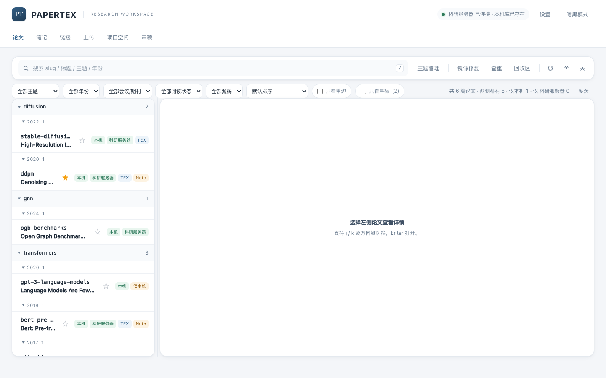
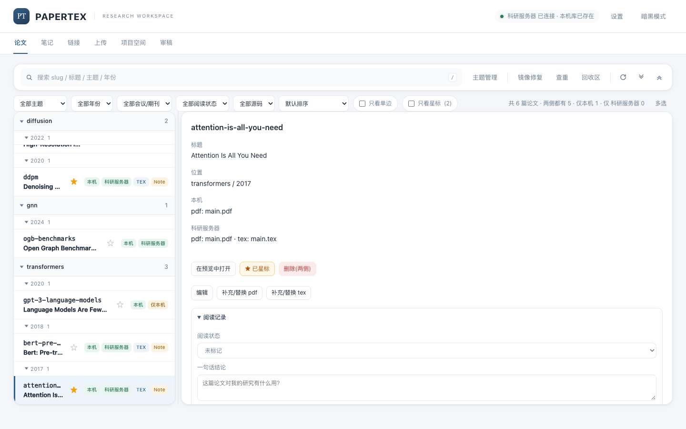
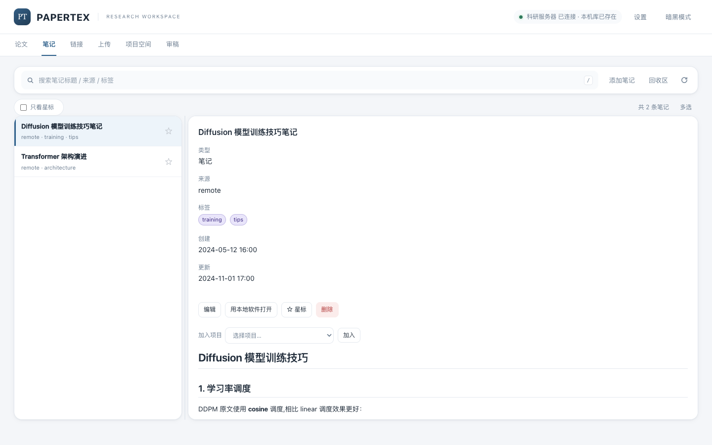
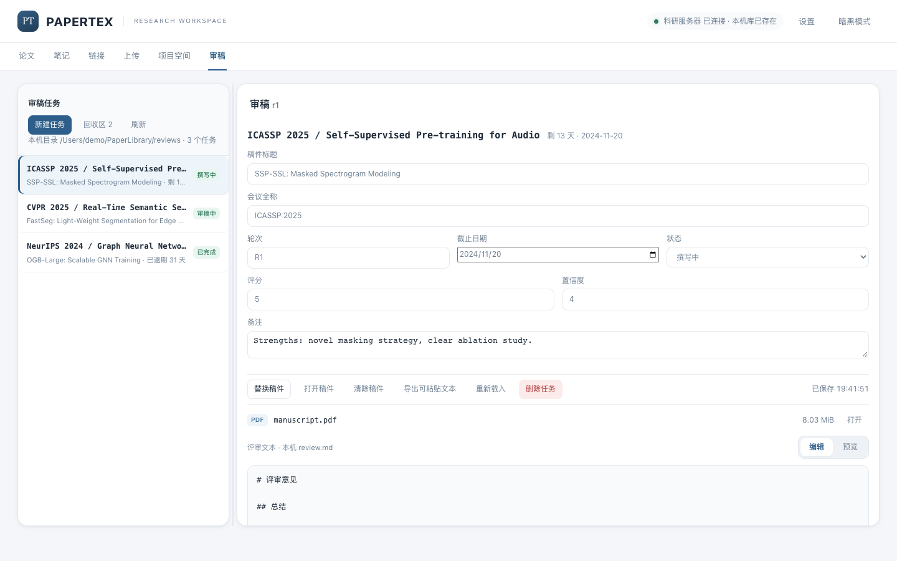
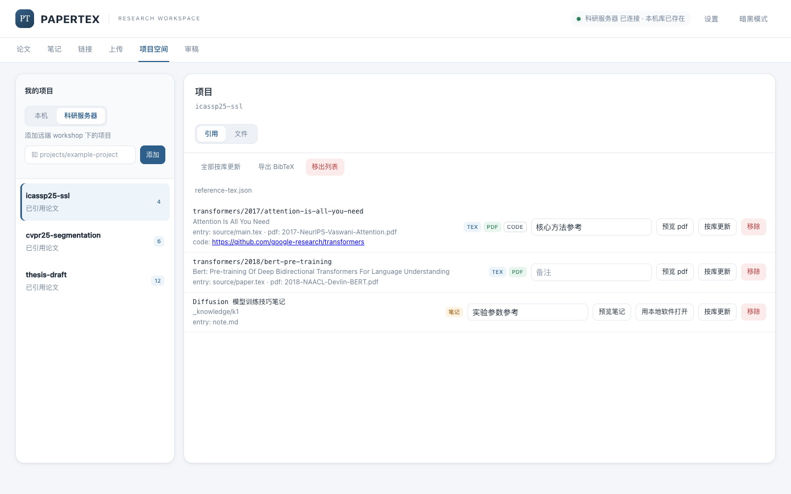

# Papertex

Papertex 是一个运行在本机的论文资料管理端。它用浏览器管理本机 PDF 镜像和远端服务器上的 PDF / LaTeX 源码，并把项目需要的论文整理成 `reference-tex.json`，方便人或 AI 直接读取。

当前版本采用「本机管理端 + SSH 远端资料库」模式，纯本地模式尚未实现。它不依赖数据库，磁盘目录就是数据源；除导入时访问 arXiv、OpenReview、IEEE 等来源外，不需要额外的云端服务。

> 下方截图使用演示数据；服务器名称、路径和论文均为示例，不代表真实资料库。

<p align="center">
  
</p>

## 功能

- **双侧论文库**：本机保存 PDF 镜像，远端保存 PDF 与 TeX 源码；列表标出两侧是否齐全，支持「只看单边」、主题/年份/会议筛选、标签、阅读状态、星标、搜索和 PDF 预览。
- **导入与补全**：支持上传 PDF 和 `.zip` / `.tar.gz` / `.tgz` 源码包；可从 arXiv、OpenReview、IEEE Xplore 抓取标题、作者、年份、会议和 PDF；也可粘贴 BibTeX 补齐书目信息。
- **项目引用**：登记远端或本机项目后，从资料库选择论文、笔记或链接加入项目，自动维护 `reference-tex.json`；支持批量加入、按库更新、导出 BibTeX，以及只读浏览项目编译出的 PDF、图片和 Markdown。
- **笔记与链接**：资料存放在远端 `_knowledge/`，支持 Markdown + KaTeX 预览、本机缓存、本地编辑器打开；本机与远端同时修改时会提示冲突，不静默覆盖。
- **阅读与整理**：阅读队列、一句话结论、自由标签、一键复制 BibTeX / `\cite{}`、论文版本关联、镜像修复、全库查重与合并、回收区恢复/清理。
- **审稿空间**：在本机独立目录管理审稿任务、稿件和 `review.md`；支持自动保存、版本冲突保护、导出可粘贴文本。审稿内容不进入论文库，也不上传远端。
- **设置与外观**：页面内维护 SSH、远端路径和监听端口，可先测试连接再保存；支持浅色/深色主题和自定义服务器显示名称。

## 界面预览

<table>
  <tr>
    <td width="50%">
      
      <br><sub>论文详情：本机 / 远端镜像、阅读记录与标签</sub>
    </td>
    <td width="50%">
      
      <br><sub>笔记与链接：Markdown / KaTeX 只读预览</sub>
    </td>
  </tr>
  <tr>
    <td width="50%">
      
      <br><sub>审稿空间：任务列表、元数据、稿件与评审正文</sub>
    </td>
    <td width="50%">
      
      <br><sub>项目引用：论文、源码、PDF 与资料统一登记</sub>
    </td>
  </tr>
</table>

## 快速开始

### 1. 准备环境

- Python 3.12。
- 本机需要 `ssh`、`scp`、`curl`；macOS 的 `open`、`mdls` 用于本地预览和读取 PDF 标题。
- 远端建议使用 Linux，并已配置 SSH 密钥登录，具备 `find`、`tar`、`sha256sum`、`cp`、`mkdir`、`mv`、`rm` 等常用命令。
- 运行应用不需要 Node.js；Node.js 仅用于可选的前端测试。

### 2. 安装并启动

```bash
python3.12 -m venv .venv
.venv/bin/python -m pip install -r requirements.txt
.venv/bin/python app/server.py
```

打开 `http://127.0.0.1:8817`。

首次启动会自动生成 `config/config.json` 并打开「设置」。如果只想先浏览本机库，可以暂时不填远端信息；远端相关功能会提示先完成配置。

### 3. 完成设置

在「设置」中填写：

1. 本机论文库和审稿目录；
2. SSH 别名（复用 `~/.ssh/config`），或主机、端口、用户名和私钥路径；
3. 远端资料库与项目根目录。

点「测试连接」确认本机路径、SSH、远端命令和目录权限都正常，再保存并重启服务。配置只保存路径和连接参数，不保存密码或私钥内容。

### 4. 开始使用

- 把已有 PDF 放进本机库，或通过「上传」导入论文与源码；
- 在「项目空间」登记项目，再从资料库把论文加入项目引用；
- AI 读取项目里的 `reference-tex.json`，先读 TeX 源码，没有源码时再读 PDF。

## 目录与数据

```text
~/PaperLibrary/<主题>/<年份>/<slug>/<slug>.pdf          # 本机 PDF 镜像
<远端资料库>/<主题>/<年份>/<slug>/                     # 远端完整论文目录
    <slug>.pdf
    source/                                             # TeX 源码
    meta.json

<远端资料库>/_knowledge/<id>/                           # 笔记 / 链接
    meta.json
    note.md

~/ReviewSpace/<会议>/<投稿号>/                          # 本机审稿空间
    manuscript.pdf
    review.md
    task.json
```

论文以「主题 → 年份 → slug」组织，跨主题关系用标签表达。项目引用清单保存在项目根目录的 `reference-tex.json`，项目自身仍可直接用文件管理器或 AI 读取。

## 安全边界

- 服务只监听回环地址，当前没有登录鉴权，不要改成 `0.0.0.0` 或反向代理到公网。
- SSH 使用系统密钥或 ssh-agent；配置和设置接口不接触密码、口令或私钥内容，并保持 SSH 主机密钥校验。
- 所有写请求需要固定的请求头；PDF 预览使用进程内临时令牌。资料库、项目和审稿目录的路径会逐段校验，拒绝越界路径和符号链接。
- 删除采用回收区而不是立即清除；恢复目标已存在时拒绝覆盖。审稿稿件和评审正文只在本机处理，不进入论文库索引、查重或项目引用。

## 测试

```bash
.venv/bin/python -B -m unittest discover -s tests -v
node --test tests/test_frontend.js
```

测试使用临时资料库和模拟网络，不连接真实 SSH 主机。

## 文档

- [完整使用手册](docs/GUIDE.md)：安装细节、全部配置项、目录约定、失败保护和接口说明。
- [功能需求文档](FUNCTIONAL_SPEC.md)：产品定位、使用场景和后续规划。
- [截图生成脚本](scripts/capture_demo_screenshots.py)：开发用，需另行安装 Playwright；通过拦截 API 生成演示截图，不读取真实资料库。

## 技术

FastAPI + 原生 JavaScript 单页应用，Python 3.12，无数据库。磁盘目录即数据源，不使用界面时仍可直接读取资料库。

## 许可证

MIT，见 [LICENSE](LICENSE)。